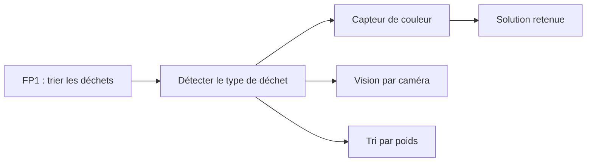

#TD 5 
Composant 1 : Le bouton 
Broche D5 (microco) S (Bouton) - l'alimentation en 3V3 à la VCc - la masse : gnd à gnd
high pas appuyé et low appuyé ( constamment high sauf si boutton poussé)
apres etape 2 : Numerotation des appuis ( qui remplace high et low)

composant 2 : Joystick 
Broche : GND - GNG ; +5V- 5V ; VRx - D0 ; VRy - D1 ; SW -D2
Résultat : au repos environ 1940 en X et Y ; si on appuie sur le joystick : select = 1  sinon select = 0
Probleme : nos premiers seuils de détection (300 et 700) étaient prévus pour
une Arduino Uno, dont le convertisseur analogique travaille sur 10 bits (0 à 1023).
Notre microcontrôleur travaille sur 12 bits (0 à 4095). La valeur au repos (≈ 1940)
dépassait donc toujours le seuil de 700, et le programme détectait « DROITE » en permanence,
même joystick lâché.
solution : dapter les seuils à la plage 0–4095. En dessous de 1000, c'est gauche ou haut ;
au-dessus de 3000, c'est droite ou bas ; entre les deux, le joystick est considéré au centre.
Cette zone morte évite les changements de direction parasites.

Composant 3 : Buzzer 
Broche : GND-GND ; S - D3 ; 3v3 - VCC
Utilisation : signaler les événements du jeu par un son
2 Types de Buzzer ; nous on a un actif
- **Actif** : produit un son fixe dès qu'il est alimenté, commandé simplement en HIGH / LOW.
- Passif : doit recevoir une fréquence (fonction `tone()`), ce qui permet de jouer différentes notes.

Composant 4 : Ecran 
Apres branchement on obtient un ecran bkanc pourquoi : couleurs sont inversé pour parer au problème :  rajout de la ligne dans VS CODE : tft.invertDisplay(false); pour obtenir : photo avec fond noir et balle jaune 

4 Composants ensemble : problème : mauvais câblage au niveau de l'écran car les fils se détachaient ou étaient mal branchés - conséquence : perte de temps car on pensait que notre code n'était pas bon
Pour rectifier le tir : tout débrancher et regarder chaque composant un à un en vérifiant les pins.

KICAD - Schématique : 
XIAO-ESP32
2 bouttons
1 Led
1 Ecran 
1 Buzzer
Ajout de 4 Condensateurs de découplage pour alimentation  car les composants tirent de l'énergie en même temps ce qui peut donner des valeurs incohérentes donc l'ajout des condensateurs permet de parer le problème  

# Études et choix techniques

{: .a_supprimer }
> Le cahier des charges dit *quoi* faire, cette page explique *comment* et **pourquoi** :
> d'abord ce qui existe déjà, puis les tests rapides, puis les choix retenus.
> Si vous avez beaucoup de choix à documenter, faites une sous-page par choix
> (ajoutez `has_children: true` ici et `parent: Études et choix techniques` dans les sous-pages).

## Recherche de l'existant

{: .a_modifier }
> Projets du MakerSpace des années précédentes, projets en ligne (Hackaday,
> Instructables, GitHub…), produits du commerce : qu'est-ce qui fait déjà quelque
> chose de proche, et qu'est-ce que vous en retenez ? Citez vos sources.
> Voir [Rechercher l'existant et étudier la faisabilité](https://doc.makerspace-amiens.fr/workshops/methodologie-de-projet/concepts/rechercher-existant-faisabilite/).

| Solution étudiée | Source | Avantages | Inconvénients | Ce qu'on retient |

| Capteur de couleur TCS3200 | Projet Hackaday similaire | Simple, bien documenté | Sensible à la luminosité ambiante | À tester sous l'éclairage réel |
| Tri par poids (balance) | Produit du commerce | Fiable, peu de composants | Ne distingue pas verre et plastique de même poids | Écarté : ne répond pas au besoin |
| Vision par caméra | Forum robotique | Précis, flexible | Complexe à mettre en œuvre dans le délai | Écarté pour ce projet, piste pour une v2 |

## Pré-étude de faisabilité

{: .a_modifier }
> Quels points techniques vous inquiétaient, et comment les avez-vous testés
> rapidement (montage sur platine d'essai, pièce imprimée de test…) ? Résultats ?
> Vous pouvez résumer ici et détailler les protocoles et mesures dans la page
> [Tests et résultats](tests.md), avec un lien vers la section concernée.

Exemple : test du capteur de couleur sous l'éclairage réel sur 30 déchets :
27 correctement identifiés.

## Choix techniques

{: .a_modifier }
> Pour chaque choix difficile à remettre en cause (composant central, architecture,
> procédé de fabrication), répondez aux quatre questions ci-dessous. Appuyez-vous
> sur des arguments **techniques** : résultats de tests, performances, contraintes
> du cahier des charges.
> Voir [Tracer ses choix techniques](https://doc.makerspace-amiens.fr/workshops/methodologie-de-projet/concepts/tracer-choix-techniques/).

Un diagramme **FAST** aide à passer d'une fonction du cahier des charges aux
solutions possibles :

### Choix : titre du choix

**Contexte :** …

**Options envisagées :** …

**Choix retenu et pourquoi :** …

**Compromis acceptés :** …
