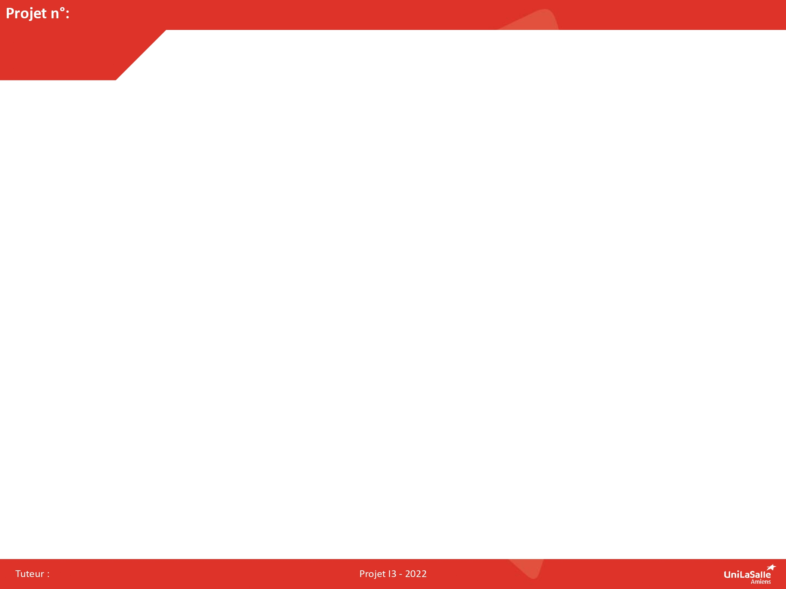

{: .a_supprimer }
> Ce site est le **template de documentation** de votre projet. Tout ce qui est
> marqué « À modifier » est un exemple à remplacer par votre contenu, tout ce qui
> est marqué « À supprimer » est une consigne à retirer avant le rendu final.
>
> Le découpage des pages est un **point de départ** : ajoutez, renommez, divisez
> les pages selon les besoins de votre projet.
>
> Les guides pour prendre en main ce template sont sur le
> [site de documentation du MakerSpace](https://doc.makerspace-amiens.fr/workshops/methodologie-de-projet/).

# Snake Multijoueur

Ce projet rentre dans la continuité de notre deuxième année de cycle pré ingénieur au sein d'UniLaSalle Amiens. Il entre dans le cours de microcontrôleur.
Le but de ce projet, est de concevoir un snake multijoueur.
- Le **joueur 1** joue au Snake sur la console que nous avons soudée en TD (microcontrôleur XIAO, écran, joystick) ;
- Le **joueur 2** rejoint la partie depuis son téléphone, en se connectant au Wi-Fi créé par la console. Il ne joue pas au même jeu : son rôle est différent, et ses actions modifient la partie du joueur 1 en temps réel.

La console sert d'arbitre, elle reçoit les actions du joueur 2, les valide et met à jour le jeu. Si le téléphone se déconnecte, la partie se met en pause au lieu de planter.

[Notre repo GitHub]({{ site.gh_edit_repository }}){: .btn .btn-primary .fs-5 .mb-4 .mb-md-0 .mr-2 }
[Notre projet sur Onshape](https://cad.onshape.com/){: .btn .fs-5 .mb-4 .mb-md-0 }

{: .a_modifier }
> Remplacez le lien du bouton « Onshape » par le lien de partage de votre document.
> Le bouton « repo GitHub » utilise l'adresse renseignée dans `docs/_config.yml`.

## Le projet en 3D



{: .a_modifier }
> Exportez votre assemblage au format **GLB** (glTF binaire) depuis Onshape
> (clic droit sur l'onglet de l'assemblage > Exporter), placez-le dans `docs/assets/models/`,
> remplacez `Otto.glb` ci-dessus par le nom de votre fichier, puis supprimez `Otto.glb`.
> Gardez le fichier sous **25 Mo**.

## Poster

{: .a_modifier }
> Remplacez `docs/assets/images/poster.jpg` par votre poster (image de moins de **2 Mo**).

## Vidéo

<video src="assets/images/intro_amiens.mp4" controls title="Présentation du projet" style="width: 100%;"></video>

{: .a_modifier }
> Remplacez `docs/assets/images/intro_amiens.mp4` par votre vidéo :
> - 1 min 30 au format vertical ;
> - présentation du projet, fonctionnement, vues du prototype, conclusion ;
> - moins de **25 Mo** (exportez en 720p, par exemple avec HandBrake).
>
> Voir [Créer le poster et la vidéo de présentation](https://doc.makerspace-amiens.fr/workshops/methodologie-de-projet/tutorials/poster-video-presentation/).
